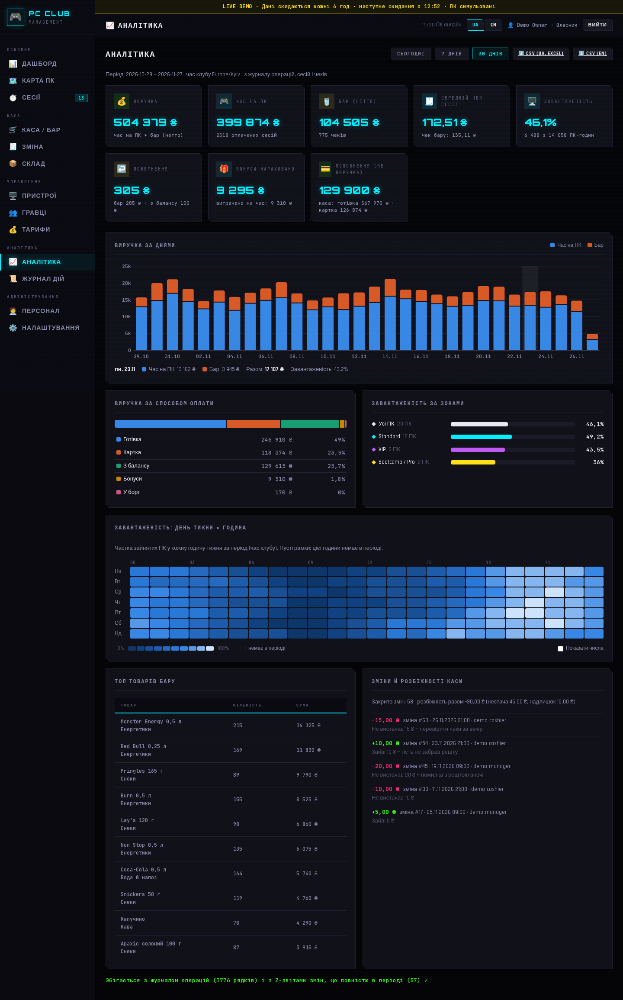
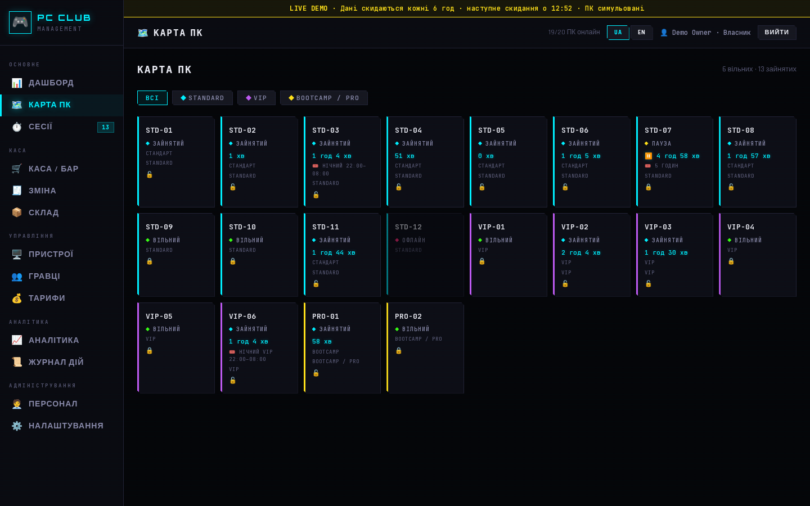
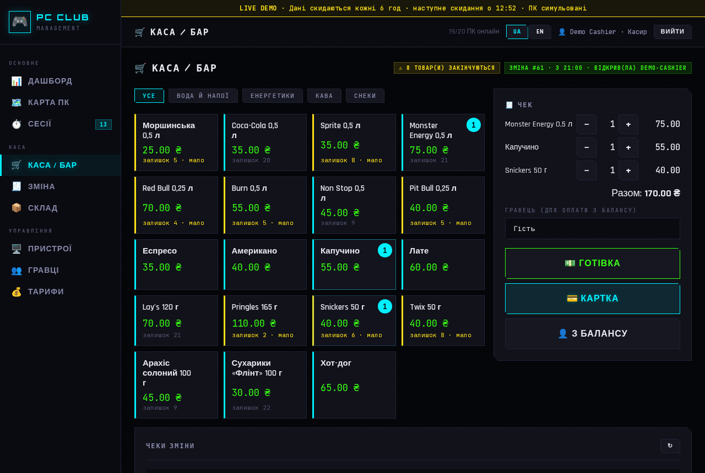
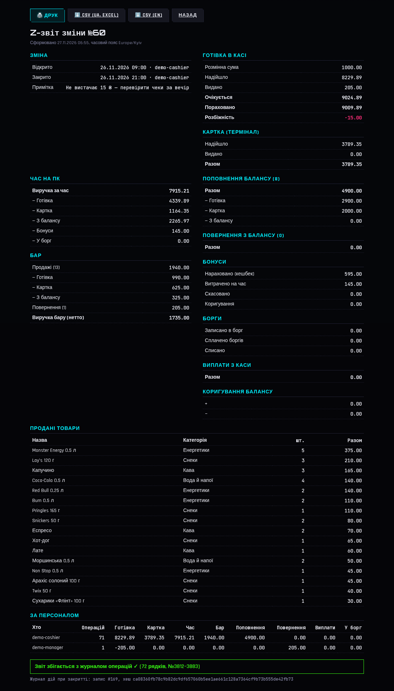
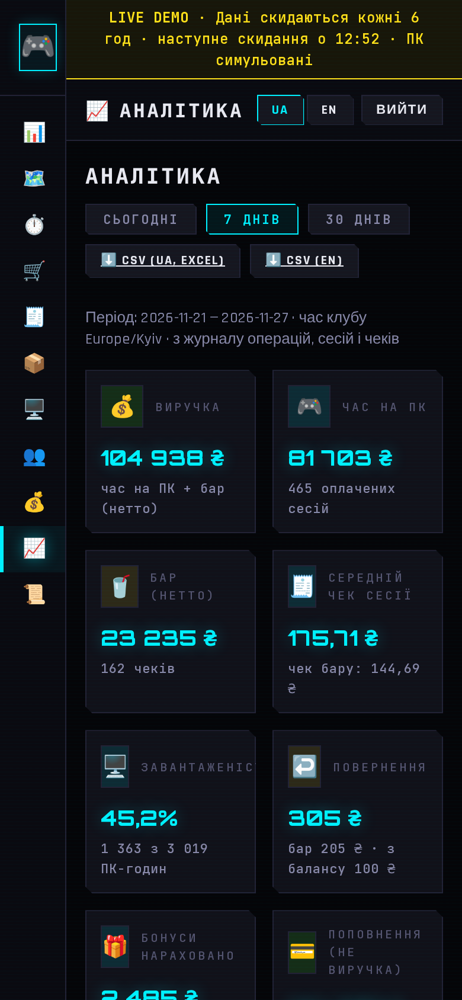
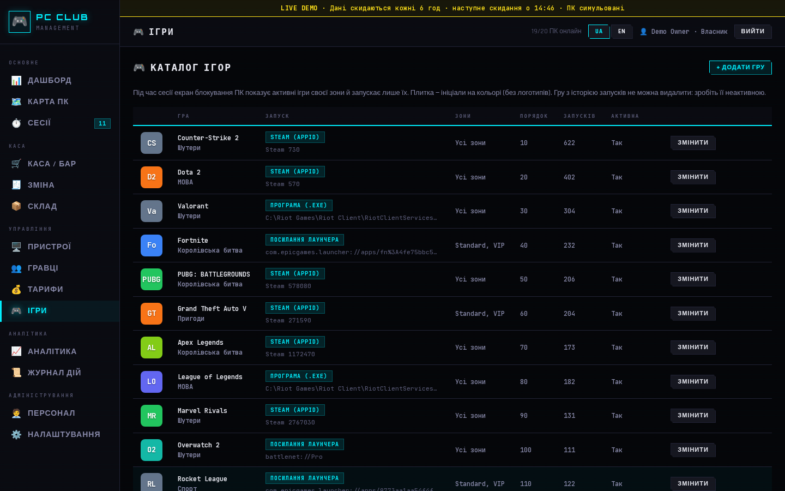
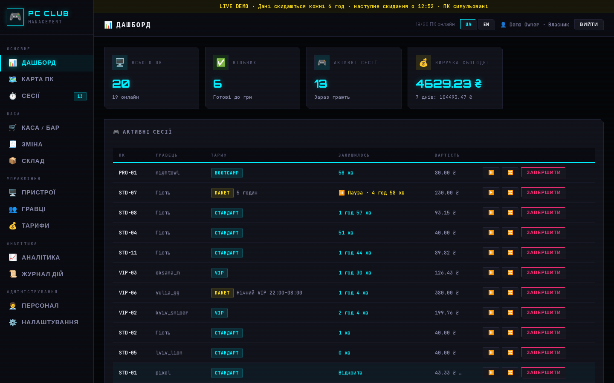

# PC Club Management System

[](https://github.com/Leev1tan/PC-Club-management-system/actions/workflows/ci.yml)
[](LICENSE)

PC Club Management System is an on-prem management platform for gaming clubs and cybersport venues. It provides central control of Windows gaming PCs, timed sessions, lock and unlock flows, device monitoring, and deployable server and client installers.

Project authorship: created and maintained by Volodymyr Shabat.

**English.** An open-source, self-hosted system to run a computer club: a live map of the PCs, sessions with time-of-day tariffs, packages and night packs, player balances with bonuses and an append-only money ledger, a bar checkout with stock, cashier shifts with blind cash counts and Z-reports, owner analytics (revenue, payment methods, occupancy per zone and hour), a tamper-evident audit log, a Windows lock-screen shell (kiosk) and remote commands. Ukrainian or English, money in UAH, EUR, USD or PLN. The server runs inside the club (on a Windows PC or in Docker), so the club keeps working when the internet is down. The gaming PCs are Windows 10/11.

**Українською.** Відкрита система керування комп'ютерним клубом, яка працює локально у вашому клубі: карта ПК, сесії з тарифами за часом доби, пакети й нічні пакети, баланси гравців із бонусами та журналом грошових операцій, каса бару зі складом, зміни касирів зі сліпим перерахунком готівки та Z-звітами, аналітика власника (виручка, способи оплати, завантаженість за зонами й годинами), журнал дій, який неможливо непомітно змінити, захищена оболонка блокування для Windows (kiosk) і віддалені команди на ПК. Сервер стоїть у клубі (на Windows-ПК або в Docker), тому клуб працює навіть без інтернету. Ігрові ПК — Windows 10/11.

## Contents

- [Screenshots](#screenshots)
- [How it works](#how-it-works)
- [Features: done and planned](#features-done-and-planned)
- [Install from a release](#install-from-a-release)
- [Run the server: two options](#run-the-server-two-options)
- [Install the club PCs (Windows)](#install-the-club-pcs-windows)
- [Demo mode](#demo-mode)
- [Security](#security)
- [Configuration](#configuration)
- [Development](#development)
- [Documentation](#documentation)
- [License](#license)

## Screenshots

**Live demo:** https://club-demo.k3s.ksm.in.ua (demo mode: 20 simulated PCs, data resets every 6 hours, nothing is real).
You can also run the same [demo mode](#demo-mode) locally: it needs only Docker.

The images below come from demo mode (30 days of simulated history; Ukrainian interface unless marked EN).

| | |
| --- | --- |
|  |  |
| **Owner analytics**: revenue by day (PC time and bar), payment methods, occupancy by zone, heatmap weekday × hour, cash variance of the shifts, check against the ledger and the Z-reports | **The same in English** (UA / EN switch in the top bar) |
|  |  |
| **PC map**: the PCs by zone, free / busy / paused / offline, time left, packages, the game each busy PC plays | **Bar checkout**: product tiles with stock, receipt, cash / card / player balance |
|  |  |
| **Z-report** of a closed shift: variance, reconciled with the ledger, audit anchor | **Analytics on a phone** (390 px wide) |
|  | |
| **Game catalog**: what the lock screens start (Steam AppID, a program, a launcher link), per zone, generated tiles (no logos) | |



## How it works

```text
 Admin browser ──HTTP──►  Club server  (Windows PC with the installer, or Docker)
                          ├─ admin UI (Next.js, static files)
                          ├─ Cms.Server API (ASP.NET Core 8)  ── PostgreSQL or SQLite
                          ▲
                          │ HTTP polling (heartbeat, commands), port 5081
 Gaming PCs (Windows 10/11)
   ├─ Cms.Agent.Service  (Windows service: registers, heartbeats, runs lock/unlock/restart/...)
   └─ Cms.Launcher       (WPF full-screen lock screen / kiosk shell, session timer)
```

| Part | Runs on | Folder |
| --- | --- | --- |
| Server API | Windows (service) or Linux/Windows container | [`Cms.Server`](Cms.Server) |
| Admin UI | served by the server (Windows) or its own container | [`admin-ui`](admin-ui) |
| Agent | every gaming PC, Windows only | [`Cms.Agent.Service`](Cms.Agent.Service) |
| Lock screen / kiosk | every gaming PC, Windows only | [`Cms.Launcher`](Cms.Launcher) |
| Shared contracts | library | [`Cms.Shared`](Cms.Shared) |
| Installers | Windows | [`scripts/installer`](scripts/installer), [`tools/Installer.Bootstrapper`](tools/Installer.Bootstrapper) |

More detail: [docs/Architecture.md](docs/Architecture.md).

### Tariffs, packages and money in short

- **Tariff** = base price per hour for a zone + rules such as "Mon–Thu 08:00–17:00: 45 ₴/h" or "every day 22:00–08:00: 40 ₴/h" (club time). Time is billed per minute and split at every rule boundary: a session 16:30–17:30 pays 30 minutes of the day price and 30 minutes of the evening price. Post-paid time is rounded up to the tariff step (1, 5, 15 minutes …) and the tariff can have a minimum charge.
- **Package** = fixed price in one zone: a duration (3 h, 5 h), a time window with a cut-off (night pack 22:00–08:00 ends at 08:00, whenever it starts), or both (morning pack). Sold from the player balance or for cash/card at the desk.
- **Pause** stops the time and locks the PC; **resume** moves the end by the paused time (never past a package cut-off). **Transfer** moves a session to a free PC; a move to a dearer zone pays the price difference for the remaining time.
- **Player money**: real balance + bonus balance. Cashback tiers add bonus on top-ups; bonus pays only for PC time, first by default. Every movement is a ledger row; refunds and corrections need Manager or Owner and a reason. A post-paid session that the player cannot pay becomes a **debt** on the player account (paid off later, or written off by a manager with a reason).

### Bar, shifts and the Z-report in short

- **Bar checkout**: product tiles by category, one receipt per sale, paid in cash, by card or from the player's real balance (bonus never pays at the bar). Products can count their stock: a sale never takes more than the stock, deliveries are logged (who, when, how many), a stock count with a reason needs Manager or Owner. A refund of a receipt needs Manager or Owner and a reason; it pays back the same way.
- **Shift**: the cashier opens a shift with a cash float. **Cash and card need an open shift**; balance payments do not (sessions end at any time). The cashier counts the cash at the close without seeing the expected amount (blind close); the server computes *expected = float + cash sales + cash top-ups + cash debt payments − cash refunds − cash payouts* and stores the variance. A closed shift cannot be changed or reopened by anybody.
- **Z-report** per shift, computed from the ledger rows of the shift: PC time, bar, top-ups, refunds, bonus, debt, payouts, cash and card, variance, and the same per staff member. Printable page and CSV (UTF-8 with BOM for Excel); the ledger of any date range as CSV for accounting.

### Owner analytics and currency in short

- **Analytics** (Owner, Manager; tab "Аналітика / Analytics"): today, 7 or 30 days in club time. **Revenue = PC time + bar (sales − refunds)**, from the ledger rows of the period with the same sums as the Z-report; split by cash, card, player balance, bonus and debt. Top-ups are deposits, not revenue, and are shown apart. Also refunds, bonus issued and spent, average session and bar receipt, top bar products and the cash variance of the closed shifts.
- **Occupancy** = play time of the PCs (session segments; a pause is not play time) ÷ (approved PCs × hours of the period up to now), per zone, per day or hour, and as a **heatmap weekday × hour** (club time, daylight saving time handled).
- **Reconciliation**: the page says whether the numbers match the ledger and the Z-reports: the shifts that lie fully in the period, plus the rows outside them, give the totals of the period. CSV of the period (UA for Excel, EN).
- **Currency** (Owner, Settings): UAH ₴ (default), EUR €, USD $ or PLN zł. It changes **only the display** and the CSV headers. Amounts in the database are **not converted**: after a change, check the prices of the tariffs, packages and bar. New ledger and audit texts take the new symbol; older rows keep theirs.

## Features: done and planned

Status of each product area. "Partial" means a basic version works and more is planned.

| # | Area | Status | Works today | Planned |
| --- | --- | --- | --- | --- |
| 1 | Lock screen and kiosk shell (Windows) | Partial | Full-screen lock, keyboard blocking, staff PIN unlock (set by the owner, checked offline), stays locked if the agent stops; player login on the lock screen (user name + PIN or password) that starts a session paid from the balance: time from the balance until it is used up, 1 / 2 / 3 h or a package of the zone; lockout per account and per PC; remaining time, player, balance and tariff on the session screen, warnings at 10, 5 and 1 minute (sound and a window on top of the game); the player ends the own session; clean session teardown: at the end of a session the lock screen closes the programs it started (with their child processes), the games and the configured launchers, chat and browsers, and (off by default) deletes configured per-user data paths, only inside allowed roots and never through links; audited | Branded background, in-shell bar orders |
| 2 | Sessions and tariffs | Partial | Tariffs per zone with time-of-day and weekday rules, per-minute billing split at every rule boundary, rounding step and minimum charge; prepaid and open-ended sessions; fixed packages (3 h, 5 h, morning pack) and night packs with a cut-off, bound to a zone; pause / resume (time stops) and transfer to another PC with the price difference; auto-lock at expiry | Promo codes and happy hours, post-paid limits for trusted players |
| 3 | Player accounts and balances | Partial | Players with salted password or PIN; real balance and a separate bonus balance (PC time only); cashback tiers on top-ups; top-up (cash/card), refund and corrections with a reason; append-only ledger of every money movement, reconciled with the balances; no negative balances, no double-spend | Loyalty tiers, bonus expiry, player web portal |
| 4 | PC map and remote control | Partial | Live PC grid by zone, online/offline, the current game, lock/unlock/log off (done by the lock screen in the player's Windows session)/message, start/extend/end session; shutdown, reboot and Wake-on-LAN (to the MAC address the agent reports) after a confirmation, for Owner, Manager and Tech only, audited | Drag-and-drop map, hardware telemetry, process kill |
| 5 | Bar / POS and stock | Partial | Product catalog with categories, touch checkout (cash, card, player balance), one receipt log, refunds with a reason (Manager+), stock per product with deliveries, stock counts with a reason and low-stock warnings | Player orders from the lock screen, combo bundles, purchase prices and margins |
| 6 | Staff roles, shifts, cash reports, audit log | Partial | Staff login with roles (Owner, Manager, Cashier, Tech); shifts with an opening float, blind close, expected cash and variance, cash payouts; Z-report per shift (printable, CSV); post-paid debt on the player account; audit log with a SHA-256 hash chain and a verify check, including emergency PIN unlocks on the PCs and free time | Staff attendance and commission |
| 7 | Seat booking | Partial | Reservations by staff for one PC or any PC of a zone (a day timeline, click to book), never double-booked (also by two cashiers at the same moment); the PC is held from 15 min before the start: the lock screen says "Reserved for <nickname> at HH:MM", other players cannot log in and other sessions need a manager override (audited); check-in starts the session (also by the player's own login); no-show auto-cancel after a grace period; optional deposit from the player balance (held in the ledger; applied, returned or kept for a no-show by a club setting); "reserved at HH:MM" on the PC map; a public booking page `/book` (off by default) that shows only the free capacity and takes requests that staff confirm; names and phone numbers erased 30 days after the slot | Online deposit by card, a page for the players' own bookings |
| 8 | Game launcher and account pool | Partial | Game catalog in the admin UI (Owner, Manager: program path and arguments, Steam AppID or a launcher link such as Epic, zones, order, active, audited); game grid on the lock screen during a session (search, categories, generated tiles, starts only catalog entries); the current game on the PC map; top games in the analytics | Club account pool, icon upload |
| 9 | Tournaments | Planned | – | Batch unlock of a zone for a match |
| 10 | Analytics and reports | Done (MVP) | Owner analytics (today / 7 / 30 days): revenue split PC time vs bar and by payment method, refunds, bonus issued and spent, average ticket, occupancy per zone, heatmap weekday × hour, cash variance of the shifts, checked against the ledger and the Z-reports; CSV of the period; Z-report per shift; ledger export of a date range as CSV (UTF-8 with BOM) | Excel (.xlsx) files, multi-club totals |
| 11 | Deployment | Partial | Windows installers, Docker compose, demo mode, CI; GitHub releases with ready Windows packages (server, agent, launcher) and SHA-256 sums | Signed installers, multi-club (public live demo: done) |
| 12 | Languages and currency | Done (MVP) | Every admin UI screen in Ukrainian and English (switch in the top bar and on the login page; dictionaries in `admin-ui/app/i18n.ts`); the lock screen (launcher) in Ukrainian and English, the language and the currency from the club settings (Owner, Settings), a UA / EN switch on the lock screen; club currency UAH / EUR / USD / PLN (display only); club time zone setting | More languages |

Every admin page and API call needs a staff login with a role; club PCs authenticate with their own device key. Read [Security](#security) before you install the system in a club.

## Install from a release

Every version tag (`v1.2.3`) creates a [GitHub release](https://github.com/Leev1tan/PC-Club-management-system/releases) with ready Windows packages. They are self-contained (win-x64), so the PCs need no .NET and no Visual Studio.

| File | Install on | Contents |
| --- | --- | --- |
| `ccms-server-<tag>-win-x64.zip` | the club server PC (option A below) | `server\` (Cms.Server.exe with the admin UI), `install-server.ps1`, `Install.cmd` |
| `ccms-agent-<tag>-win-x64.zip` | every gaming PC | `agent\` (ClubAgent service), `install-client.ps1`, `uninstall-kiosk.ps1`, `Install.cmd` |
| `ccms-launcher-<tag>-win-x64.zip` | every gaming PC | `launcher\` (lock screen) |
| `SHA256SUMS` | | SHA-256 of the three zips |

Each zip also holds `LICENSE`, `NOTICE.md` and `INSTALL.txt`.

1. Download the zips and `SHA256SUMS`. Compare the SHA-256 of each zip with its line in `SHA256SUMS`:
   PowerShell `Get-FileHash .\ccms-server-v1.2.3-win-x64.zip`, Linux `sha256sum -c SHA256SUMS`.
   The packages are not code-signed, so Windows SmartScreen can say "unknown publisher".
2. Server PC: extract the server zip and run `Install.cmd` as Administrator (options as in [A](#a-windows-pc-in-the-club-installer)).
   The installer prints the one-time setup code and the enrollment token.
3. Every gaming PC: extract the agent zip **and** the launcher zip into the same folder, then run as Administrator:
   ```powershell
   Install.cmd -ServerUrl "http://<server-ip-or-router>:5081" -EnrollmentToken "<token>" -KioskMode
   ```
4. For the Docker option the release has no files: CI publishes the images to `ghcr.io` for the same tags.

Maintainers: `git tag v1.2.3 && git push origin v1.2.3` starts the workflow [Release](.github/workflows/release.yml) (windows-latest: server tests, admin UI build, the three publishes, zips, `SHA256SUMS`, then `gh release create`). *Actions → Release → Run workflow* is a dry run: the same files as a workflow artifact, no release. The same files on a Windows build PC: build the admin UI (`cd admin-ui; npm ci; npm run build`), then `pwsh scripts/release/build-release.ps1 -Version v1.2.3`.

## Run the server: two options

The club PCs are always Windows. For the **server** you can choose:

| | **A. Windows PC in the club (installer)** | **B. Docker compose (Linux, or Windows with Docker)** |
| --- | --- | --- |
| Install | `ClubServerSetup.exe` (built by `scripts/installer/build-packages.ps1`) | `docker compose up -d` |
| Runs as | Windows service `ClubServer` | 3 containers: PostgreSQL, API, admin UI |
| Database | SQLite (default) or PostgreSQL | PostgreSQL 16 in a container (volume `ccms-pgdata`) |
| Club URL (UI + API) | `http://<server-ip>:5081` | `http://<server-ip>:5081` (same) |
| Client PCs find the server | LAN auto-discovery (UDP 5082) or `-ServerUrl` | `-ServerUrl` only (no UDP discovery from containers) |
| Update | build new packages and run the installer again | rebuild or pull images, `docker compose up -d` |

Both options serve the same API on the same URL, so the client install and the MikroTik rules in [docs/ClubDeployment.md](docs/ClubDeployment.md) are the same.

### A. Windows PC in the club (installer)

1. Take the server zip of a [release](#install-from-a-release), or, on a Windows build PC with the .NET 8 SDK and Node.js 22, build the packages:
   ```powershell
   powershell -ExecutionPolicy Bypass -File scripts\installer\build-packages.ps1
   ```
   Output: `publish\installers\ClubServerSetup.exe` and `ClubClientSetup.exe` (plus zip packages).
2. On the club server PC, run as Administrator:
   ```powershell
   ClubServerSetup.exe                     # SQLite database in C:\ProgramData\PCClub\cms.db
   # options: -HttpPort 5081 -DataPath C:\ProgramData\PCClub -EnrollmentToken <token>
   #          -PostgresConnectionString "Host=...;Database=cms;Username=...;Password=..."
   ```
   At the end the installer prints the **one-time setup code** and the **enrollment token** for the club PCs.
3. Check: `Invoke-RestMethod http://localhost:5081/health` returns `healthy`.
4. First start: open `http://<server-ip>:5081`, enter the setup code (also in `C:\ProgramData\PCClub\setup-code.txt`) and create the Owner account. Then set the staff PIN for the lock screens (Settings) and create accounts for the staff (Staff).

Full guide with network and router rules: [docs/ClubDeployment.md](docs/ClubDeployment.md).

### B. Docker compose (Linux, or Windows with Docker)

Needs Docker Engine with the compose plugin (Linux) or Docker Desktop (Windows).

```bash
git clone https://github.com/Leev1tan/PC-Club-management-system.git
cd PC-Club-management-system
cp .env.example .env          # set POSTGRES_PASSWORD (letters and digits) and CMS_ENROLLMENT_TOKEN
docker compose up -d          # first run builds the two images
docker compose exec server cat /app/data/setup-code.txt   # one-time code for the first Owner
```

First start: open `http://<server-ip>:5081`, enter the setup code and create the Owner account. Instead of the setup screen you can set `CMS_INITIAL_OWNER_USERNAME` and `CMS_INITIAL_OWNER_PASSWORD` in `.env` for the first start (remove the password afterwards). Then set the staff PIN for the lock screens (Settings).

- Admin UI and API: `http://<server-ip>:5081` (the admin-ui container proxies `/api` to the server).
- Health: `http://<server-ip>:5081/api/health`
- API docs: `http://<server-ip>:5081/swagger`
- Logs: `docker compose logs -f server` · Stop: `docker compose down` (data stays in the volume).

The database schema is created and upgraded automatically at start (EF Core migrations). Images: `ccms-server` (ASP.NET Core 8, non-root, port 8080) and `ccms-admin-ui` (static UI on unprivileged nginx, port 3000). CI publishes them to `ghcr.io/<owner>/ccms-server` and `ghcr.io/<owner>/ccms-admin-ui` for version tags `v*`.

## Install the club PCs (Windows)

Games run on the club PCs, and these are Windows 10/11 machines. Each PC gets the agent (a Windows service) and the lock-screen launcher (WPF). Run on each gaming PC as Administrator:

```powershell
ClubClientSetup.exe -ServerUrl "http://<server-ip-or-router>:5081" -EnrollmentToken "<token>"
```

With the enrollment token the PC is approved at once. Without it, the PC appears as "pending" in the admin UI (Devices) and does nothing until staff approve it. Add `-KioskMode` for the lock-screen shell. This works the same for both server options. See [docs/ClubDeployment.md](docs/ClubDeployment.md) for the club network (switch isolation, MikroTik NAT, acceptance checks).

## Demo mode

Demo mode shows the system without any Windows PCs. With `DEMO_MODE=true` the server:

- seeds a demo club with typical Ukrainian prices (₴): zones Standard (12 PCs), VIP (6) and Bootcamp/Pro (2); zone tariffs with weekday-day, weekend-day, evening and night prices; 3 h and 5 h packs, a morning pack and a night pack (22:00–08:00) per zone; cashback 5/10/15 % on top-ups; 24 regular players whose balances and bonuses come from their ledger history (top-ups, cashback, sessions, packages, a refund, a correction); **30 days of play** that follow the day of a real club (quiet mornings, full evenings, night packs, busier weekends: about 80 sessions a day, 46 % occupancy) and live sessions (packages, a paused session, an open-ended one); no PC and no player has two sessions at once;
- seeds a bar in UAH (energy drinks, coffee, snacks, water; two products low on stock), 12-hour shifts back to back for the whole history (the demo cashier's shift is open; yesterday's day shift closed 15 ₴ short, four older ones with small differences), receipts, deliveries, a stock count, a refunded receipt, a cash payout, a player with a debt and an audit log with a valid hash chain. **Every seeded shift is closed with the same code as a real close and stores its audit anchor**, so the chain check verifies 60 anchors;
- simulates the 20 PCs: heartbeats (with a MAC address), and it runs queued commands (lock, unlock, session start/extend/end, reboot, shutdown, message, log off) like a real agent; Wake-on-LAN is simulated (no network traffic, and the audit log says "simulated"): it starts a shut-down PC, or the offline PC for 10 minutes; a shut-down PC that nobody wakes comes back after 3 minutes; so the PC map changes live; one PC stays offline on purpose; walk-in guests (cash or card) and players (from the balance) start sessions and buy packages now and then, and sessions are paused and resumed; the bar sells something every minute or so; when a visitor closes the shift, the demo cashier opens the next one after three minutes;
- wipes and re-seeds everything on start and every `DEMO_RESET_HOURS` hours (default 6), in one transaction and in about 1 s (the first reset after a start takes about 2 s); the log line shows the time;
- seeds a game catalog of 18 entries (well-known games, Steam and Discord; names only, generated tiles: Steam, Epic and Battle.net links, Riot programs, some only in some zones, one inactive) and the games played in every session of the history, so the PC map shows what each busy PC plays and the analytics show the top games; the simulated players start and switch games;
- seeds about 15 reservations for today and tomorrow (players with and without a deposit, invented walk-in names, "any PC" of VIP) and two requests of the public booking page (invented names, phone numbers of the UK drama range +44 7700 900xxx); the simulated cashier checks most guests in around their start, about one in four becomes a no-show, and new reservations are booked now and then; the booking page `/book` is on and shows a banner: the data is deleted at the next reset, do not enter real data;
- seeds four public demo staff accounts and shows them on the login page (see below);
- shows a "LIVE DEMO" banner in the admin UI, blocks `DELETE` requests, agent registration and changes of staff accounts, passwords and settings (the club currency is allowed: it changes only the display), and never connects to the internet.

Run it locally:

```bash
DEMO_MODE=true docker compose up -d      # then open http://localhost:5081
```

Safety: demo mode wipes its database. It refuses to start (exit code 1) on a database that contains data it did not create, so do not point it at a real club database; use a separate, empty one.

Logins (they exist **only in demo mode**; outside demo mode the server never creates an account by itself):

| User name | Password | Role |
| --- | --- | --- |
| `demo-owner` | `demo` | Owner |
| `demo-manager` | `demo` | Manager |
| `demo-cashier` | `demo` | Cashier |
| `demo-tech` | `demo` | Tech |

The login page shows these accounts as buttons. The demo player account **`demo` / `demo`** exists only in the demo database; the other seeded players use the same password. All demo data is fictional. Real lock screens log in with `POST /api/devices/{id}/player-login` (device key); the older public `POST /api/users/login` only checks a player password and starts nothing.

Public demo behind an ingress (for example k3s): run one server replica, route `/` to `admin-ui:3000` and `/api` to `server:8080` (or route everything to `admin-ui:3000`), and add rate limiting at the ingress.

## Security

What protects a club installation (phase 2). Report security problems to the author (contact in [NOTICE.md](NOTICE.md)).

**Staff login and roles.** Every admin API call needs a staff login. The login is an HTTP-only, `SameSite=Strict` cookie (also `Secure` over HTTPS). Changing a password, a role or deactivating an account ends its logins at once. Passwords are hashed with ASP.NET Core Identity's PasswordHasher (salted PBKDF2). Five wrong passwords lock that user name for 15 minutes for that client IP; login is also rate limited per IP.

| Role | May do |
| --- | --- |
| Owner | everything, including staff accounts and settings (staff PIN, club currency) and the check of the audit hash chain |
| Manager | sessions, reservations with their settings and the override of a hold, players, refunds and balance/bonus corrections, tariffs and their rules, packages, cashback, zones, deletes, revenue and the analytics tab (with its CSV), ledger and its CSV export, audit log; bar products and prices, stock counts, refunds of receipts, cash payouts, debt write-off, free time with a reason; closes any shift and sees the expected cash live |
| Cashier | sessions (start with a tariff or a package, pause, resume, transfer, extend, end), reservations (create, move, cancel, check in; **not** the override of a hold or the reservation settings), players, top-ups, debt payments, PC commands (lock, unlock, message, log off; **not** shutdown, reboot or Wake-on-LAN); bar checkout and deliveries; opens a shift and closes **own** shift (blind: the expected cash is shown after the count), Z-report of own closed shifts; reads tariffs and packages; **not**: tariff/package/cashback/product changes, zones, deletes, refunds, corrections, stock counts, payouts, free time, revenue, analytics, ledger, audit log |
| Tech | PC map, devices (commands, zones, approval, shutdown, reboot, Wake-on-LAN); nothing else |

**First start (no staff account yet).** The server never creates a default account. Either set `CMS_INITIAL_OWNER_USERNAME` and `CMS_INITIAL_OWNER_PASSWORD` (at least 8 characters) for the first start, or use the setup screen of the admin UI with the one-time code in `<data directory>/setup-code.txt`:

- Docker: `docker compose exec server cat /app/data/setup-code.txt`
- Windows installer: printed at the end of `ClubServerSetup.exe`, also in `C:\ProgramData\PCClub\setup-code.txt` (readable only by Administrators)

Both work only while no staff account exists; the code is deleted when the Owner is created.

**CSRF and CORS.** State-changing requests with the login cookie must send the header `X-CCMS-CSRF: 1` and a matching `Origin`; CORS allows the same origin only (`Cors__AllowedOrigins` for a UI on another origin). Scripts that use the API with a cookie must send the header too.

**Club PCs.** The server stores only a SHA-256 hash of each device key, and registration never returns the key of an existing PC. A new PC needs the enrollment token (`CMS_ENROLLMENT_TOKEN`, installer option `-EnrollmentToken`) or staff approval in the admin UI (Devices: approve, reject, revoke). The agent keeps its key and the token in `C:\ProgramData\ClubAgent\private` (no access for players) and deletes the token after the first registration; it sends the token only to an explicit `-ServerUrl`, never to a server found by LAN discovery.

**Player login on the lock screen.** The lock screen runs as the player and never sees the device key: it asks the agent through a local named pipe (players may read and write it, but cannot create it while the agent runs; the lock screen talks only to a pipe server whose process id is the agent's, from `state.json`), and the agent calls `POST /api/devices/{id}/player-login` with its key. A wrong user name and a wrong PIN get the same answer in the same time. Five failures for one user name (also a name that does not exist) lock that name for 15 minutes on every PC; ten failures on one PC lock the login of that PC for 15 minutes (the club PCs share the router IP, so the limit is per PC, not per IP). Failures and lockouts are in the audit log (`player.login_failed`, `player.login_locked`); a name that is not an account is not written down, because players type passwords into the name field. Lockouts are kept in memory (a server restart clears them). A Manager or the Owner sees the current lockouts in the admin UI (Players, "Login lockouts on the PCs") and clears one for a name or for a PC (`player.login_lockout_cleared`); a locked name that is not an account is listed without its text.

**Session teardown.** What the lock screen closes and deletes at the end of a session is set on each PC in `C:\ClubAgent\appsettings.json`, section `Teardown` (administrators only; the server never sends it, so nobody can order deletions over the network). It closes only processes of the player's Windows session, never Windows processes or the shell. The cleanup of per-user data (browser profiles, chat and launcher logins) is **off** by default; when on, it deletes only the listed paths inside the allowed roots (`%LOCALAPPDATA%`, `%APPDATA%` by default), never a drive or a root itself, and never follows a symbolic link, junction or other reparse point (a planted link is skipped, its target is not touched). Every teardown is in the audit log (`device.session_teardown`). See [docs/ClubDeployment.md](docs/ClubDeployment.md#session-teardown).

**Lock screen.** There is no default staff PIN. The owner sets it in the admin UI (Settings, at least 8 characters); the server stores and sends only a PBKDF2 hash (600 000 iterations), and the launcher checks the PIN locally, so `Ctrl+Shift+U` + PIN also works while the server or the agent is down. The lock screen fails closed: when the agent heartbeat is older than 15 s or its state is missing, the PC stays locked. Three wrong PINs pause the prompt for 30 s, doubling up to 15 minutes.

**Money.** Every money movement is one row of an append-only ledger (`LedgerEntries`: top-up, refund, correction, session charge, package purchase, cashback, cashback reversal; walk-in guest payments at the desk too). A database trigger refuses `UPDATE` and `DELETE` on it, and a player with ledger rows cannot be deleted. Balance changes are single conditional database updates in the same transaction as the ledger row, so a balance (real or bonus) cannot go negative and cannot be spent twice; each row stores the balances after it, and `GET /api/ledger/reconcile` checks that every balance equals the sum of its rows. Bonus pays only for PC time and is never paid out; a refund takes back the cashback of the refunded amount. The database allows only one active session per PC. A post-paid session takes at most the balances; the rest is due at the desk (cash or card) or, for a registered player who cannot pay, is recorded as the player's debt (`Users.Debt`, a ledger row with `DebtDelta`; reconciled like the balances); a player with a debt gets no new open-ended session. Every ledger row belongs to the shift that was open; **cash and card rows need an open shift** (`Shifts:RequireOpenShift`, default `true`; the database context refuses such a row and the API answers 409 `shift_required`). Receipts (`Sales`, `SaleItems`) and the stock log (`StockMovements`) are append-only like the ledger; a closed shift cannot be changed, reopened or deleted (trigger). On the first start of phase 3, the balances and the history of an earlier version were copied into the ledger once.

**Reservations.** A reservation is for one PC or for any PC of a zone, a start and a duration, for a registered player or a walk-in name. Every change runs under one reservation lock (PostgreSQL: transaction advisory lock; SQLite: one writer), so two cashiers cannot book the same PC or the last PC of a zone at the same moment. From `HoldMinutes` (15) before the start until `GraceMinutes` (15) after it, the PC is held: the lock screen shows only the nickname of the player or the first name of the guest (never a phone or a surname), a player login of another player is refused, and a cashier start or transfer on the PC needs the override of the Owner or a Manager (`reservation.hold_overridden`). The player's own login (or the cashier's check-in) starts the session by the normal billing rules. Without a check-in a job cancels the reservation (`reservation.no_show`). A deposit comes only from the real balance of a player: a ledger row `deposit_hold` holds it; at check-in `deposit_release` puts it back and the session is paid from it; a cancel by staff returns it; a no-show keeps it (`deposit_kept`, PC time revenue paid from the balance) or returns it, by the club setting. `GET /api/ledger/holds` checks every deposit against its rows. Audit texts of reservations never contain a walk-in name or a phone number.

**Public booking page.** `/book` needs no login and is **off** until the Owner or a Manager turns it on (Reservations → settings; on in the demo). It shows the zones, the days (14 ahead) and, per start time, only the number of free PCs, never other bookings. A request (name and phone, nothing else) is a reservation "requested" that holds no PC until staff confirm it. Limits: 5 requests per IP address in 10 minutes and 120 reads a minute (`Booking:RequestsPerIpPer10Minutes`, `Booking:ReadsPerIpPerMinute`), 3 requests a day and at most 2 open requests or reservations per phone number (any format of the same number), a hidden honeypot field, short fields and a body of at most 2 KB. Name and phone are shown only to staff, never written to the audit log (the request's audit row also has no IP), and erased `EraseAfterDays` (30) after the slot by a background job (`reservation.personal_data_erased`, ids only). To offer the page on the internet, publish only `/book`, `/_next/` and `/api/public/booking` through an HTTPS reverse proxy (see [docs/ClubDeployment.md](docs/ClubDeployment.md#public-booking-page)).

**Audit log.** Logins, failed logins, staff and settings changes (also the club currency), PC approval and commands, unlocks without an active session ("time without payment"), **emergency staff PIN unlocks on the PCs** (the lock screen checks the PIN offline and leaves a note that the agent sends later), **free time** (a free session or extension needs Owner or Manager and a reason; a 0 ₴ price is logged too), sessions (start, extend, pause, resume, transfer, end), top-ups, refunds, balance and bonus corrections, debts (recorded, paid, written off), tariff, package, cashback and **product price** changes, **stock** deliveries and counts, **refunds of receipts**, **shift** open, close and cash payouts are written to an append-only table (a database trigger refuses `UPDATE` and `DELETE`). Owner and Manager see it read-only in the admin UI (Audit log).

**Tamper evidence.** Each audit row stores `Hash = SHA-256(PrevHash + "\n" + canonical content)` (time, actor, role, action, target, summary, details, IP). `GET /api/audit/verify` (Owner; button in the admin UI) recomputes the chain and reports the first broken row: changed content, a removed or inserted row, a row without a hash. Each closed shift stores the last audit row and its hash (printed on the Z-report); verify checks these anchors, so even a rewrite of the whole chain shows. Rows of an earlier version get their hashes once at the first start.

**Limits (read before you go live).**

- The club LAN uses plain HTTP on port 5081, so passwords, cookies and device keys cross the LAN unencrypted. Keep the server and the PCs in a network that players cannot sniff (switch port isolation, see [docs/ClubDeployment.md](docs/ClubDeployment.md)), or put an HTTPS reverse proxy in front and set `Auth__CookieSecure=always`. Never publish port 5081 to the internet without HTTPS.
- The staff PIN hash is readable on every club PC (the launcher needs it offline). Use a long PIN with letters and digits, and change it when staff leave.
- Players who are local administrators on a club PC can stop the agent or read its key; the kiosk install keeps players as standard users.
- The audit log is append-only in the application and the database and forms a SHA-256 hash chain. A database administrator can still change rows; verify then finds the change. Someone who can write to the database can also recompute the whole chain; only the head hashes printed on closed Z-reports (keep them) show such a rewrite. The chain has no secret key.
- The note of an emergency PIN unlock is written by the lock screen, which runs as the player. Players cannot read, change or delete the notes (inbox ACL), but a player who is a local administrator, or who kills the lock screen before it writes, can avoid it; a player can also plant fake notes (at most 30 per PC and hour are recorded). Not yet tested on a Windows PC: the inbox ACL and the agent upload were built for Windows but run only in the server tests here.
- The cashier closes blind, but sees each receipt of the shift; a cashier who adds them up can guess the expected cash. The variance is in the Z-report and the audit log in any case.

## Configuration

Server settings (environment variables; in `appsettings.json` use `:` instead of `__`):

| Variable | Default | Meaning |
| --- | --- | --- |
| `ConnectionStrings__DefaultConnection` | empty | PostgreSQL connection string. Empty, or one that contains `localhost`, selects SQLite. |
| `Database__Provider` | auto | `postgres` or `sqlite` to override the automatic choice (the installer sets it). |
| `Storage__DataDirectory` | Windows: `C:\ProgramData\PCClub`; else `<app>/data` (`/app/data` in the image) | Absolute data directory: SQLite file, login cookie keys, setup code. |
| `Database__SqlitePath` | `<data directory>/cms.db` | SQLite file; a relative path is resolved against the data directory. A `cms.db` of an earlier version (working directory, install folder or `C:\Windows\System32`) is copied there once. |
| `CMS_INITIAL_OWNER_USERNAME` / `CMS_INITIAL_OWNER_PASSWORD` | empty | First Owner account; used only while no staff account exists. |
| `CMS_ENROLLMENT_TOKEN` (or `Devices__EnrollmentToken`) | empty | Secret for the agent installer; PCs with it are approved at once. |
| `Devices__AllowPendingRegistration` | `true` | PCs without the token wait for approval; `false` refuses them. |
| `Auth__SessionHours` | `12` | Login lifetime (sliding). |
| `Auth__CookieSecure` | `auto` | `always` = login cookie only over HTTPS (behind an HTTPS proxy). |
| `Auth__LoginRateLimitPerMinute` | `20` (`300` in demo mode) | Login, setup and agent registration attempts per client IP. |
| `ReverseProxy__TrustForwardedHeaders` | `false` (`true` in the image) | Take the client IP and scheme from `X-Forwarded-*` (only when the server is reachable through the proxy only). |
| `ReverseProxy__ForwardLimit` | `1` | Number of proxies in front of the server (2 = ingress + admin-ui container). |
| `Retention__HeartbeatDays` / `Retention__HeartbeatSampleMinutes` | `7` / `5` | Keep heartbeat samples 7 days; store one sample per PC per 5 minutes. |
| `Retention__CommandDays` / `Retention__CommandExpireMinutes` | `30` / `60` | Delete finished commands after 30 days; a command not delivered in 60 minutes expires and never runs. |
| `Urls` / `ASPNETCORE_URLS` | `http://0.0.0.0:5081` (`http://+:8080` in the image) | Listen address. |
| `Club__TimeZone` | `Europe/Kyiv` | Club time zone for time-of-day tariff rules and package windows (IANA or Windows id). Docker: `CMS_TIMEZONE`; Windows installer: `-TimeZone`. |
| `Shifts__RequireOpenShift` | `true` | Cash and card payments need an open shift. `false` only for a club that does not use shifts (balance payments never need one). Docker: `CMS_REQUIRE_OPEN_SHIFT`. |
| `Booking__RequestsPerIpPer10Minutes` / `Booking__ReadsPerIpPerMinute` | `5` / `120` | Limits of the public booking page per client IP (requests, availability reads). |
| `DEMO_MODE` | `false` | Demo club and simulated PCs. |
| `DEMO_RESET_HOURS` | `6` | Demo reset interval; `0` = reset only on start. |
| `Cors__AllowedOrigins` | empty | Comma-separated origins, only if the UI is served from another origin (same origin only by default). |
| `Discovery__Enabled` | `true` (`false` in the image) | UDP LAN discovery on port 5082. |
| `Power__WakeBroadcast` / `Power__WakePort` | `255.255.255.255` / `9` | Where the server sends Wake-on-LAN packets: the broadcast address of the club LAN (for example `10.3.3.255`) or a relay; UDP port 7 or 9. A wrong value turns Wake-on-LAN off (logged; the admin UI says so). Docker: `CMS_WAKE_BROADCAST`, `CMS_WAKE_PORT`; the container network cannot broadcast into the club LAN, see [docs/ClubDeployment.md](docs/ClubDeployment.md#wake-on-lan). Not used in demo mode (simulated). |

The reservation settings (hold before the start, default 15 min; no-show after the start, default 15 min; the deposit of a no-show kept or returned, default kept; the public booking page, default off; erase names and phone numbers after 30 days; 2 open requests per phone number) are set by the Owner or a Manager in the admin UI (Reservations) and stored in `ClubSettings` (`reservations.settings`, audited).

The club currency (UAH, EUR, USD, PLN) and the lock screen language (Ukrainian, English) are not environment variables: the Owner sets them in the admin UI (Settings); they are stored in the database (`ClubSettings`, keys `club.currency` and `club.language`) and audited. The club PCs get both with every heartbeat; a PC that never reached the server shows Ukrainian and ₴, a PC that lost the server keeps the last values it got.

Admin UI container: `API_UPSTREAM` (default `http://server:8080`) is where `/api`, `/swagger` and `/health` are proxied. The UI always calls the API on its own origin; the build argument `NEXT_PUBLIC_API_URL` can point it to another origin.

Docker compose (`.env`): `POSTGRES_PASSWORD`, `CMS_ENROLLMENT_TOKEN`, `CMS_INITIAL_OWNER_USERNAME` / `CMS_INITIAL_OWNER_PASSWORD`, `CMS_PORT` (5081), `CMS_BIND_ADDRESS` (0.0.0.0), `CMS_TIMEZONE` (Europe/Kyiv), `CMS_REQUIRE_OPEN_SHIFT` (true), `CMS_WAKE_BROADCAST` / `CMS_WAKE_PORT`, `DEMO_MODE`, `DEMO_RESET_HOURS`, `CMS_SERVER_IMAGE`, `CMS_UI_IMAGE`. See [.env.example](.env.example). Server data (cookie keys, setup code) is in the volume `ccms-serverdata`, the database in `ccms-pgdata`.

## Development

| Task | Command |
| --- | --- |
| Run the API (SQLite) | `dotnet run --project Cms.Server` |
| Run the API in demo mode | `DEMO_MODE=true dotnet run --project Cms.Server` |
| Tests | `dotnet test tests/Cms.Server.Tests` (add `CMS_TEST_POSTGRES=<connection string>` to run the PostgreSQL tests too) |
| Admin UI dev server | `cd admin-ui && npm ci && NEXT_PUBLIC_API_URL=http://localhost:5081 npm run dev` (server with `Cors__AllowedOrigins=http://localhost:3000`) |
| Admin UI build (static, `admin-ui/out`) | `cd admin-ui && npm run build` (downloads fonts at build time) |
| New database migration (PostgreSQL) | `dotnet ef migrations add <Name> --project Cms.Server` |
| Agent and launcher | Windows with the .NET 8 SDK or Visual Studio 2022 |

CI ([.github/workflows/ci.yml](.github/workflows/ci.yml)) builds and tests the server on Ubuntu, builds the agent and the launcher on Windows, builds the admin UI and both Docker images. The release workflow ([.github/workflows/release.yml](.github/workflows/release.yml)) builds the Windows packages for a version tag (see [Install from a release](#install-from-a-release)).

## Documentation

- [Architecture](docs/Architecture.md)
- [Project Plan](docs/ProjectPlan.md)
- [Club Deployment Guide](docs/ClubDeployment.md)
- [Test Checklist](docs/TestChecklist.md)

## License

Copyright (C) Volodymyr Shabat. See [NOTICE.md](NOTICE.md).

This program is free software: you can redistribute it and/or modify it under the terms of the GNU Affero General Public License as published by the Free Software Foundation, either version 3 of the License, or (at your option) any later version (**AGPL-3.0-or-later**). See [LICENSE](LICENSE).

If you run a modified version for other people over a network, the AGPL requires you to offer them its source code. A commercial license without these obligations can be arranged with the author (contact in [NOTICE.md](NOTICE.md)).
