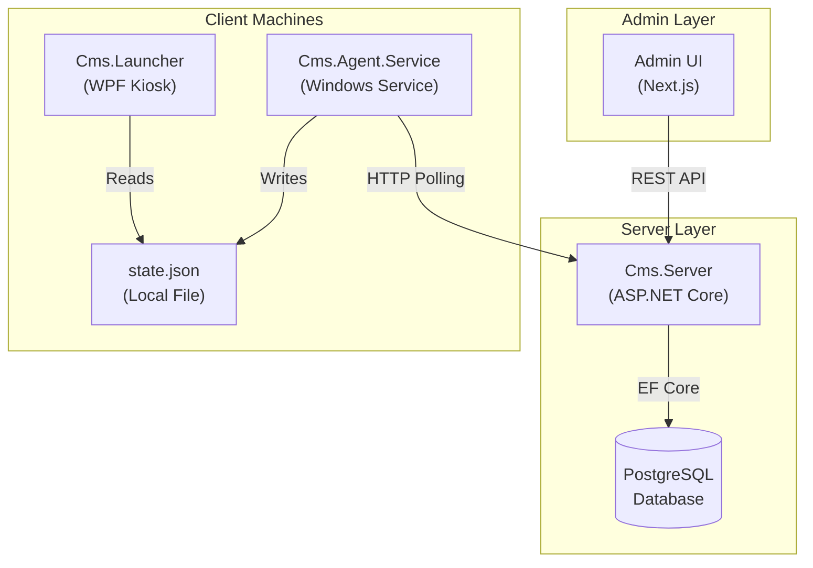
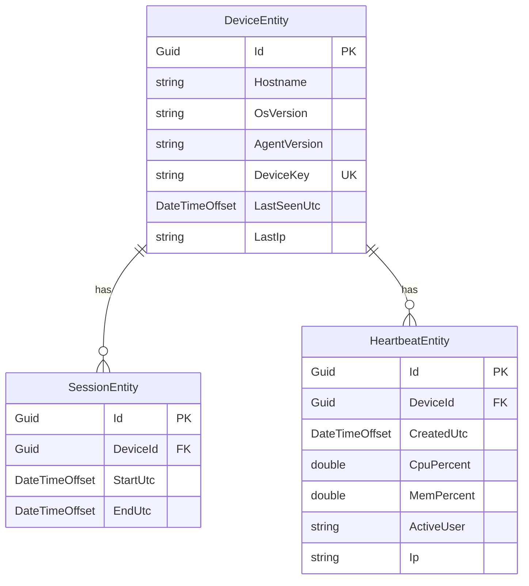
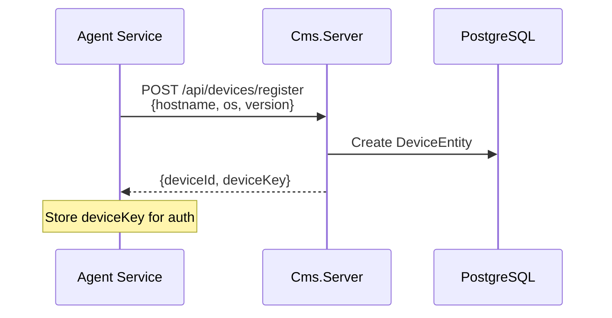
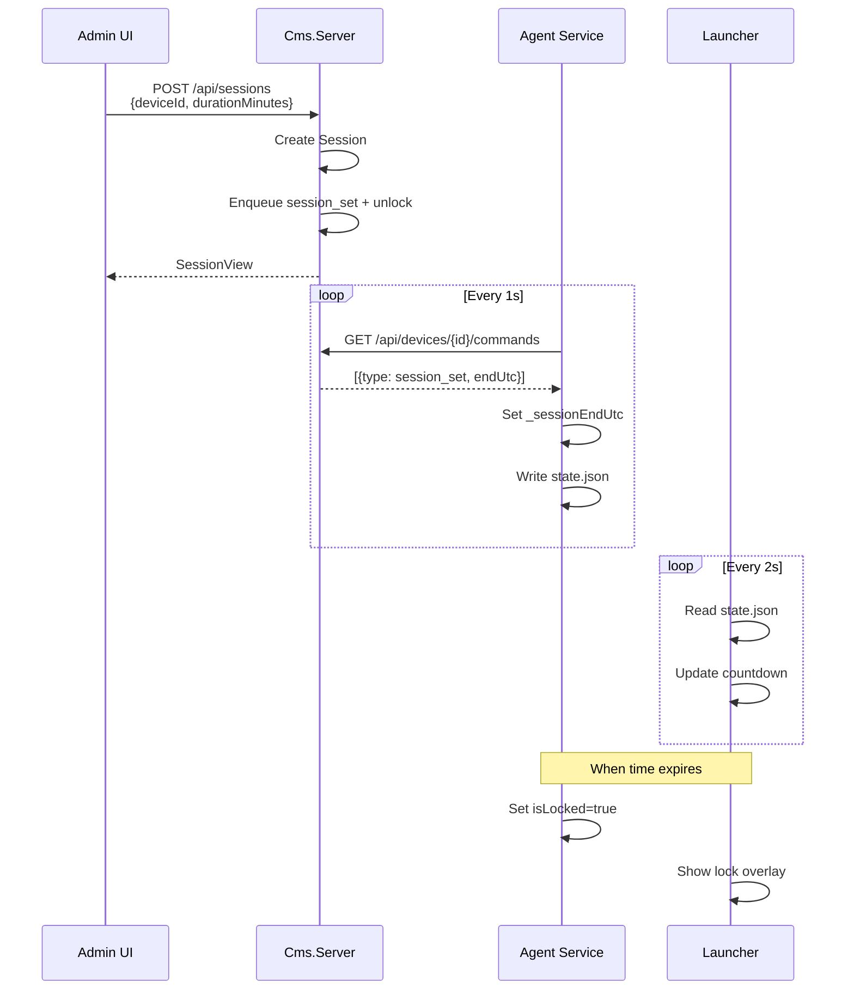

# PC Club Management System — Architecture

Project authorship: created and maintained by Volodymyr Shabat.

## Overview

The PC Club Management System is a distributed application for managing gaming PCs in a cybersport club environment. It enables central control of Windows gaming stations including session management with time limits, device locking/unlocking, and remote commands.



---

## Solution Structure

| Project | Type | Description |
|---------|------|-------------|
| [Cms.Server](../Cms.Server) | ASP.NET Core Web API | Central management server with REST endpoints |
| [Cms.Agent.Service](../Cms.Agent.Service) | .NET Worker Service | Windows background service running on each PC |
| [Cms.Launcher](../Cms.Launcher) | WPF Application | Kiosk UI with lock screen overlay |
| [Cms.Shared](../Cms.Shared) | Class Library | Shared contracts (currently minimal) |
| [admin-ui](../admin-ui) | Next.js | Web dashboard for administrators |

---

## Component Details

### 1. Cms.Server (Central API)

**Technology**: ASP.NET Core 8, Entity Framework Core, PostgreSQL

**Entry Point**: [Program.cs](../Cms.Server/Program.cs)

**Key Components**:

| File | Purpose |
|------|---------|
| [DevicesController.cs](../Cms.Server/Controllers/DevicesController.cs) | Device registration, heartbeats, command queue |
| [SessionsController.cs](../Cms.Server/Controllers/SessionsController.cs) | Session start/end, duration management |
| [CmsDbContext.cs](../Cms.Server/Data/CmsDbContext.cs) | EF Core DbContext with entity definitions |
| [IDeviceRepository.cs](../Cms.Server/Repositories/IDeviceRepository.cs) | Device operations interface |
| [ISessionRepository.cs](../Cms.Server/Repositories/ISessionRepository.cs) | Session operations interface |

**REST API Endpoints** (who may call them in brackets; see the README security section):

```
POST /api/auth/login | logout | setup | password, GET /api/auth/me | status   → staff login (cookie)
GET/POST/PUT /api/staff                     → staff accounts                  [Owner]
GET/PUT/DELETE /api/settings[/staff-pin]    → lock-screen staff PIN           [Owner]
GET  /api/audit                             → audit log, read-only            [Owner, Manager]

POST /api/devices/register       → Register a PC: enrollment token, current key, or "pending"   [agent]
POST /api/devices/heartbeat      → Agent heartbeat; returns status + staff PIN hash             [X-Device-Key]
GET  /api/devices/{id}/commands  → Poll pending commands                          [X-Device-Key, approved]
POST /api/devices/{id}/commands/{cmdId}/ack → Acknowledge command                 [X-Device-Key, approved]
GET  /api/devices                → List all devices                               [all staff]
POST /api/devices/{id}/commands  → Enqueue lock/unlock/restart/logoff/message     [all staff]
POST /api/devices/{id}/approve | reject | revoke, PUT .../zone                    [Owner, Manager, Tech]

POST /api/sessions               → Start new session                              [Owner, Manager, Cashier]
POST /api/sessions/{id}/end      → End session early
POST /api/sessions/{id}/extend   → Add minutes to a prepaid session
GET  /api/sessions               → List all sessions
GET  /api/sessions/revenue       → Revenue                                        [Owner, Manager]
POST /api/users/login            → Player login on the lock screen (password or PIN required)   [public, rate limited]

GET  /health, /api/health        → Health check                                   [public]
GET  /api/demo                   → Demo mode status (banner in the admin UI)      [public]
```

---

### 2. Cms.Agent.Service (Windows Service)

**Technology**: .NET 8 Worker Service, runs as Windows Service

**Entry Point**: [Worker.cs](../Cms.Agent.Service/Worker.cs)

**Responsibilities**:
1. **Registration**: with the enrollment token from the installer (approved at once) or without it
   (the PC waits for staff approval); stores `deviceId` and `deviceKey` in `ClubAgent\private`
2. **Heartbeat Loop**: Sends a heartbeat every 5 seconds; receives its status and the staff PIN hash
3. **Command Polling**: Fetches and executes pending commands from server
4. **Session Enforcement**: Tracks session end time, manages lock state
5. **State File Management**: Writes `state.json` for Launcher to read

**Supported Commands**:

| Command | Action |
|---------|--------|
| `lock` | Lock the PC (write lock state to file) |
| `unlock` | Unlock the PC |
| `restart` | Schedule system restart in 5 seconds |
| `message` | Log message (UI popup planned) |
| `session_set` | Set session end time |

**Local State Communication** (written every second, also while the server is unreachable):
```
%ProgramData%\ClubAgent\          # players: read only (installer ACL)
├── state.json           # Lock state, remaining seconds, time of the last lock change
├── agent_heartbeat.txt  # Agent liveness marker (the launcher locks when it is older than 15 s)
├── staff-pin.json       # PBKDF2 hash of the staff PIN (from the server)
└── private\             # SYSTEM, Administrators, agent only
    ├── device.json            # device id + key
    └── enrollment-token.txt   # from the installer; deleted after the first registration
```

---

### 3. Cms.Launcher (Kiosk UI)

**Technology**: WPF (.NET 8), runs in full-screen kiosk mode

**Entry Point**: [MainWindow.xaml.cs](../Cms.Launcher/MainWindow.xaml.cs)

**Features**:
- Full-screen overlay when PC is locked
- Session countdown timer display
- Keyboard blocking when locked (via [KeyboardBlocker.cs](../Cms.Launcher/KeyboardBlocker.cs))
- Staff unlock with the staff PIN (`Ctrl+Shift+U`); the owner sets the PIN in the admin UI, the
  launcher verifies it locally against `staff-pin.json`, so it also works offline. No default PIN.
- Fail closed: stays locked when the agent heartbeat is older than 15 s or `state.json` is missing

**State Polling**:
- Reads `state.json` every 2 seconds
- Shows/hides lock overlay based on `isLocked` field
- Displays remaining time from `remainingSeconds` field

---

### 4. Admin UI (Next.js)

**Technology**: Next.js 15 (static export), React 19, Tailwind CSS

**Entry Point**: [page.tsx](../admin-ui/app/page.tsx)

**Features**:
- Real-time device list (polls every 5 seconds)
- Device status indicators (online/offline)
- Quick action buttons: Lock, Unlock, Restart, Start Session
- Session duration prompt

---

## Data Model



---

## Communication Flow

### Device Registration


### Session Lifecycle


---

## Deployment Architecture

```
┌─────────────────────────────────────────────────────────────┐
│                     Admin Workstation                        │
│  ┌─────────────────┐                                        │
│  │   Admin UI      │◄────────────── HTTP :3000              │
│  │   (Next.js)     │                                        │
│  └────────┬────────┘                                        │
│           │                                                  │
└───────────┼──────────────────────────────────────────────────┘
            │ REST API
            ▼
┌─────────────────────────────────────────────────────────────┐
│                      Server (On-Prem)                        │
│  ┌─────────────────┐     ┌─────────────────┐                │
│  │   Cms.Server    │────►│   PostgreSQL    │                │
│  │   (Kestrel)     │     │   :5432         │                │
│  │   :5081         │     └─────────────────┘                │
│  └─────────────────┘                                        │
└───────────┬──────────────────────────────────────────────────┘
            │ HTTP Polling
            ▼
┌─────────────────────────────────────────────────────────────┐
│                    Gaming PC (Windows 11)                    │
│  ┌─────────────────┐     ┌─────────────────┐                │
│  │ Cms.Agent       │────►│ state.json      │                │
│  │ (Windows Svc)   │     └────────┬────────┘                │
│  └─────────────────┘              │                         │
│                                   ▼                         │
│                      ┌─────────────────┐                    │
│                      │  Cms.Launcher   │                    │
│                      │  (WPF Kiosk)    │                    │
│                      └─────────────────┘                    │
└─────────────────────────────────────────────────────────────┘
```

---

### Server deployment options

The club PCs always run Windows (agent + launcher). The server has two equal options:

| | Windows PC (installer) | Docker compose |
|---|---|---|
| Server process | `ClubServer` Windows service (`Cms.Server.exe`) | `ccms-server` container (Linux, ASP.NET Core 8) |
| Admin UI | static files in the server `wwwroot` | `ccms-admin-ui` container (nginx), proxies `/api` to the server |
| Database | SQLite (default) or PostgreSQL | PostgreSQL 16 container |
| Club URL | `http://<server>:5081` | `http://<server>:5081` |
| Schema | SQLite: created on start; PostgreSQL: EF Core migrations on start | EF Core migrations on start |

In both cases the admin UI calls the API on its own origin (`/api/...`). For a public demo behind an
ingress, route `/` to the admin UI and `/api` to the server. See the [README](../README.md) for
commands and [ClubDeployment.md](ClubDeployment.md) for the club network.

---

## Security Considerations

| Aspect | Implementation |
|--------|----------------|
| **Staff login** | Cookie (HTTP-only, SameSite=Strict), roles Owner / Manager / Cashier / Tech, CSRF header + Origin check |
| **Passwords** | ASP.NET Core Identity PasswordHasher (salted PBKDF2) for staff and players |
| **Agent Authentication** | `X-Device-Key` header; the server stores only its SHA-256 hash |
| **PC enrollment** | Enrollment token from the installer, or staff approval of a pending PC |
| **CORS** | Same origin only; `Cors:AllowedOrigins` for exceptions |
| **Staff Unlock** | Staff PIN set by the owner, PBKDF2 hash verified locally by the launcher |
| **Fail-Closed** | Launcher stays locked when the agent is silent (>15 s) |
| **Audit log** | Append-only table (database trigger), read-only page for Owner and Manager |

---

## Technology Stack

| Layer | Technology |
|-------|------------|
| **Server** | .NET 8, ASP.NET Core, EF Core, PostgreSQL |
| **Agent** | .NET 8 Worker Service, Windows Service |
| **Launcher** | .NET 8, WPF, Windows Low-Level Keyboard Hook |
| **Admin UI** | Next.js 15 (static export), React 19, Tailwind CSS |
| **Build** | Visual Studio 2022, dotnet CLI, npm |

---

## Related Documentation

- [ProjectPlan.md](ProjectPlan.md) — Strategy, milestones, and detailed planning
- [TestChecklist.md](TestChecklist.md) — Manual testing procedures
