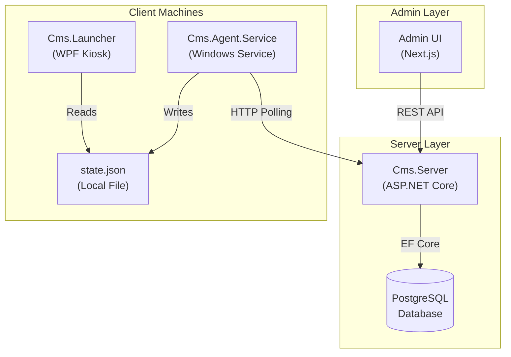
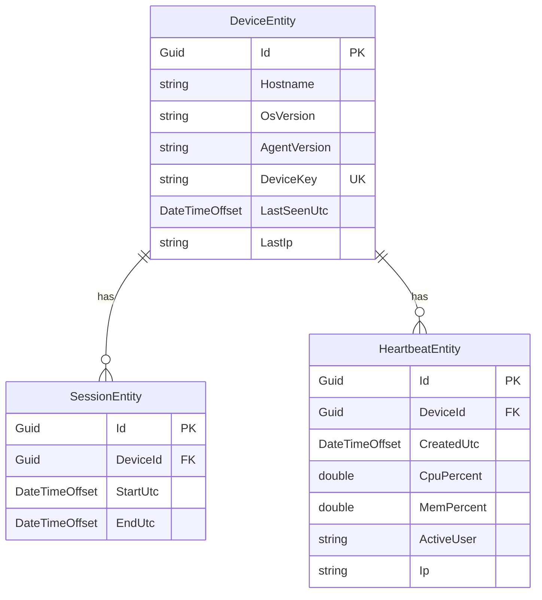
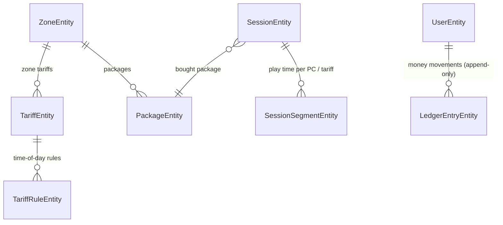
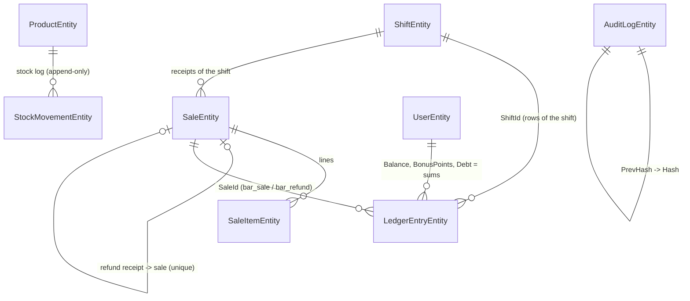
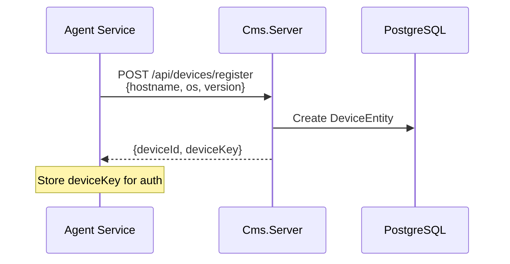
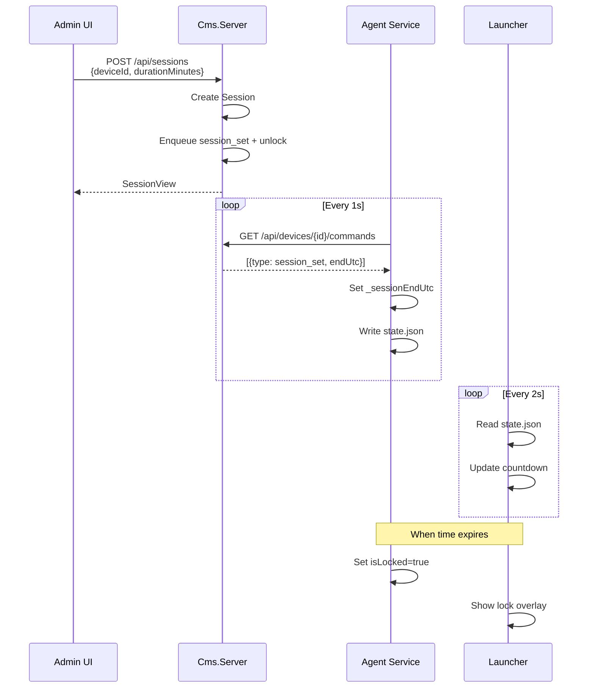

# PC Club Management System — Architecture

Project authorship: created and maintained by Volodymyr Shabat.

## Overview

The PC Club Management System is a distributed application for managing gaming PCs in a cybersport club environment. It enables central control of Windows gaming stations including session management with time limits, device locking/unlocking, and remote commands.



---

## Solution Structure

| Project | Type | Description |
|---------|------|-------------|
| [Cms.Server](../Cms.Server) | ASP.NET Core Web API | Central management server with REST endpoints |
| [Cms.Agent.Service](../Cms.Agent.Service) | .NET Worker Service | Windows background service running on each PC |
| [Cms.Launcher](../Cms.Launcher) | WPF Application | Kiosk UI with lock screen overlay |
| [Cms.Shared](../Cms.Shared) | Class Library | Shared contracts: lock decision, staff PIN hash, agent files, client settings |
| [Cms.Client](../Cms.Client) | Class Library (net8.0) | Logic of the agent and the lock screen that is tested on Linux: launcher texts (UA / EN), and more in later parts |
| [admin-ui](../admin-ui) | Next.js | Web dashboard for administrators |

---

## Component Details

### 1. Cms.Server (Central API)

**Technology**: ASP.NET Core 8, Entity Framework Core, PostgreSQL

**Entry Point**: [Program.cs](../Cms.Server/Program.cs)

**Key Components**:

| File | Purpose |
|------|---------|
| [DevicesController.cs](../Cms.Server/Controllers/DevicesController.cs) | Device registration, heartbeats, command queue |
| [SessionsController.cs](../Cms.Server/Controllers/SessionsController.cs) | Sessions: start (tariff or package), end, extend, pause, resume, transfer |
| [Billing/SessionService.cs](../Cms.Server/Billing/SessionService.cs) | Session rules and money handling (used by the API and the demo simulator) |
| [Billing/TariffCalculator.cs](../Cms.Server/Billing/TariffCalculator.cs) | Prices of PC time per time-of-day rule, rounding, minimum charge |
| [Billing/PackageWindows.cs](../Cms.Server/Billing/PackageWindows.cs) | When a package is on sale and when it ends (cut-off) |
| [Billing/Wallet.cs](../Cms.Server/Billing/Wallet.cs) | Atomic balance, bonus and debt changes, append-only ledger, reconciliation |
| [Shifts/ShiftService.cs](../Cms.Server/Shifts/ShiftService.cs) | Open / close a shift, expected cash, cash payouts, the shift lock of ledger rows |
| [Shifts/ZReport.cs](../Cms.Server/Shifts/ZReport.cs) | Z-report of a shift from its ledger rows |
| [Shifts/LedgerTotals.cs](../Cms.Server/Shifts/LedgerTotals.cs) | Sums of ledger rows by section, shared by the Z-report and the analytics |
| [Analytics/AnalyticsService.cs](../Cms.Server/Analytics/AnalyticsService.cs) | Owner analytics of a period: revenue, payment methods, occupancy, heatmap, checks |
| [Analytics/AnalyticsCsv.cs](../Cms.Server/Analytics/AnalyticsCsv.cs) | CSV of the analytics period |
| [Billing/ClubCurrency.cs](../Cms.Server/Billing/ClubCurrency.cs) | Club currency (UAH, EUR, USD, PLN), display only |
| [Data/BulkInsert.cs](../Cms.Server/Data/BulkInsert.cs) | Bulk insert of complete rows from the EF model (demo reset) |
| [Demo/DemoSeeder.cs](../Cms.Server/Demo/DemoSeeder.cs) | Demo club: 30 days of history, anchored shifts, fast reset |
| [Shifts/CsvExport.cs](../Cms.Server/Shifts/CsvExport.cs) | CSV (UTF-8 with BOM) of the Z-report and of the ledger for a date range |
| [Pos/SaleService.cs](../Cms.Server/Pos/SaleService.cs) | Bar checkout and refunds of receipts |
| [Pos/Stock.cs](../Cms.Server/Pos/Stock.cs) | Atomic stock changes, the stock log, stock reconciliation |
| [Auth/AuditChain.cs](../Cms.Server/Auth/AuditChain.cs) | SHA-256 hash chain of the audit log, one-time seal of older rows, verify |
| [Auth/DeviceEvents.cs](../Cms.Server/Auth/DeviceEvents.cs) | Events reported by a PC afterwards (emergency staff PIN unlock) |
| [CmsDbContext.cs](../Cms.Server/Data/CmsDbContext.cs) | EF Core DbContext with entity definitions |
| [IDeviceRepository.cs](../Cms.Server/Repositories/IDeviceRepository.cs) | Device operations interface |
| [ISessionRepository.cs](../Cms.Server/Repositories/ISessionRepository.cs) | Session operations interface |

**REST API Endpoints** (who may call them in brackets; see the README security section):

```
POST /api/auth/login | logout | setup | password, GET /api/auth/me | status   → staff login (cookie);
                                              login and me carry the club currency (ISO code)
GET/POST/PUT /api/staff                     → staff accounts                  [Owner]
GET/PUT/DELETE /api/settings[/staff-pin]    → lock-screen staff PIN; GET lists the currencies  [Owner]
PUT  /api/settings/currency                 → club currency UAH | EUR | USD | PLN, display only, audited  [Owner; allowed in the demo]
PUT  /api/settings/language                 → lock screen language uk | en, audited; sent to the PCs with the heartbeat  [Owner; allowed in the demo]
GET  /api/analytics?period=today|7d|30d (or from=&to=)  → owner analytics of club days  [Owner, Manager]
GET  /api/analytics/export.csv?period=&lang=&sep=       → the same period as CSV (UTF-8 BOM)  [Owner, Manager]
GET  /api/audit                             → audit log, read-only, with the hash of each row  [Owner, Manager]
GET  /api/audit/verify                      → recompute the hash chain, first broken row         [Owner]

POST /api/devices/register       → Register a PC: enrollment token, current key, or "pending"   [agent]
POST /api/devices/heartbeat      → Agent heartbeat; returns status, staff PIN hash and the club settings
                                   of the lock screen (client: language, currency)              [X-Device-Key]
GET  /api/devices/{id}/commands  → Poll pending commands                          [X-Device-Key, approved]
POST /api/devices/{id}/commands/{cmdId}/ack → Acknowledge command                 [X-Device-Key, approved]
GET  /api/devices                → List all devices                               [all staff]
POST /api/devices/{id}/commands  → Enqueue lock/unlock/restart/logoff/message     [all staff]
POST /api/devices/{id}/approve | reject | revoke, PUT .../zone                    [Owner, Manager, Tech]
POST /api/devices/{id}/events    → Agent: emergency staff PIN unlock noted by the lock screen  [X-Device-Key, approved]

POST /api/sessions               → Start: tariff (prepaid minutes or open-ended) or packageId;   [Owner, Manager, Cashier]
                                   paymentMethod balance | cash | card, useBonus; free + reason [Owner, Manager]
POST /api/sessions/{id}/end      → End; open-ended: billed per segment, balances first, rest at the desk
                                   (deskMethod cash | card) or as the player's debt (deskMethod debt)
POST /api/sessions/{id}/extend   → Add minutes to a prepaid or package session (never past a cut-off)
POST /api/sessions/{id}/pause | resume            → Stop / restart the time (PC locks / unlocks)
GET  /api/sessions/{id}/transfer-quote?targetDeviceId= , POST /api/sessions/{id}/transfer → move to a free PC
GET  /api/sessions               → List all sessions (active open-ended: currentCost)
GET  /api/sessions/revenue       → Revenue (PC time + bar net) of today, 7 and 30 club days, from the ledger  [Owner, Manager]
GET  /api/tariffs, POST /api/tariffs/quote        → Tariffs with rules, price of prepaid minutes   [front desk]
POST/PUT/DELETE /api/tariffs     → Tariff with its rule list                      [Owner, Manager]
GET  /api/packages[?zoneId|deviceId]              → Package catalog, "on sale now" and end time    [front desk]
POST/PUT/DELETE /api/packages    → Package catalog                                [Owner, Manager]
GET  /api/billing/settings, PUT  → Club time zone, cashback tiers (PUT: Owner, Manager)
POST /api/users/{id}/topup       → Top-up in cash or by card, cashback            [front desk]
POST /api/users/{id}/refund | adjust              → Refund / correction of balance or bonus, reason  [Owner, Manager]
POST /api/users/{id}/debt/pay    → Debt paid in cash, by card or from the balance          [front desk]
POST /api/users/{id}/debt/writeoff → Debt written off with a reason                         [Owner, Manager]
GET  /api/users/{id}/ledger[/check]               → Player ledger, reconciliation with the balances  [front desk]
GET  /api/ledger, /api/ledger/reconcile           → Club ledger (read-only), reconciliation of all players  [Owner, Manager]
GET  /api/ledger/export.csv?from=&to=&lang=&sep=  → Ledger of a club-time date range as CSV (UTF-8 BOM)  [Owner, Manager]

GET  /api/shifts/current         → Open shift, expected cash (Owner, Manager only: blind close)  [front desk]
POST /api/shifts                 → Open a shift with an opening float (one open shift)          [front desk]
POST /api/shifts/{id}/close      → Close with the counted cash: expected cash and variance      [opener, Owner, Manager]
POST /api/shifts/{id}/payout     → Cash out of the drawer with a reason                         [Owner, Manager]
GET  /api/shifts[/{id}]          → Shifts (cashier: own shifts)                                 [front desk]
GET  /api/shifts/{id}/report[.csv] → Z-report (cashier: own shift after the close)              [front desk]
GET  /api/products[?includeInactive|lowStockOnly], /{id}, /movements → catalog, stock log      [front desk]
POST/PUT/DELETE /api/products    → Products and prices (delete only without history)            [Owner, Manager]
POST /api/products/{id}/restock  → Delivery: who, when, how many                                [front desk]
POST /api/products/{id}/correction → Stock count with a reason                                  [Owner, Manager]
GET  /api/products/stock/check   → Stock against the stock log                                  [Owner, Manager]
POST /api/sales, GET /api/sales[/{id}] → Bar checkout (cash | card | balance), receipt log      [front desk]
POST /api/sales/{id}/refund      → Refund of a receipt with a reason                            [Owner, Manager]
POST /api/users/login            → Player login on the lock screen (password or PIN required)   [public, rate limited]

GET  /health, /api/health        → Health check                                   [public]
GET  /api/demo                   → Demo mode status (banner in the admin UI)      [public]
```

---

### 2. Cms.Agent.Service (Windows Service)

**Technology**: .NET 8 Worker Service, runs as Windows Service

**Entry Point**: [Worker.cs](../Cms.Agent.Service/Worker.cs)

**Responsibilities**:
1. **Registration**: with the enrollment token from the installer (approved at once) or without it
   (the PC waits for staff approval); stores `deviceId` and `deviceKey` in `ClubAgent\private`
2. **Heartbeat Loop**: Sends a heartbeat every 5 seconds; receives its status and the staff PIN hash
3. **Command Polling**: Fetches and executes pending commands from server
4. **Session Enforcement**: Tracks session end time, manages lock state
5. **State File Management**: Writes `state.json` for Launcher to read

**Supported Commands**:

| Command | Action |
|---------|--------|
| `lock` | Lock the PC (write lock state to file) |
| `unlock` | Unlock the PC |
| `restart` | Schedule system restart in 5 seconds |
| `message` | Log message (UI popup planned) |
| `session_set` | Set the session end time; `{"endUtc": null}` = no end (open-ended or paused session) |

**Local State Communication** (written every second, also while the server is unreachable):
```
%ProgramData%\ClubAgent\          # players: read only (installer ACL)
├── state.json           # Lock state, remaining seconds, time of the last lock change
├── agent_heartbeat.txt  # Agent liveness marker (the launcher locks when it is older than 15 s)
├── staff-pin.json       # PBKDF2 hash of the staff PIN (from the server)
├── client-settings.json # club settings for the lock screen: language (uk, en), currency (from the heartbeat)
├── inbox\               # players: create files only (no read, change, delete)
│   └── event-*.json     # note of an emergency PIN unlock (launcher); the agent sends it, then deletes it
└── private\             # SYSTEM, Administrators, agent only
    ├── device.json            # device id + key
    └── enrollment-token.txt   # from the installer; deleted after the first registration
```

---

### 3. Cms.Launcher (Kiosk UI)

**Technology**: WPF (.NET 8), runs in full-screen kiosk mode

**Entry Point**: [MainWindow.xaml.cs](../Cms.Launcher/MainWindow.xaml.cs)

**Features**:
- Full-screen overlay when PC is locked
- Session countdown timer display
- Keyboard blocking when locked (via [KeyboardBlocker.cs](../Cms.Launcher/KeyboardBlocker.cs))
- Staff unlock with the staff PIN (`Ctrl+Shift+U`); the owner sets the PIN in the admin UI, the
  launcher verifies it locally against `staff-pin.json`, so it also works offline. No default PIN.
- Fail closed: stays locked when the agent heartbeat is older than 15 s or `state.json` is missing
- Every successful staff PIN unlock leaves a note in `ClubAgent\inbox`; the agent sends it to
  `POST /api/devices/{id}/events` (audit `device.emergency_unlock`), also later when it was down

**Languages**: every text is in `Cms.Client/LauncherTexts.cs` (Ukrainian and English, each text a required
member, so a text missing in one language does not compile). The language and the currency come from
`client-settings.json`; without it the lock screen is Ukrainian with ₴. The UA / EN button on the lock screen
switches the language until the PC locks again.

**State Polling**:
- Reads `state.json` every 2 seconds
- Shows/hides lock overlay based on `isLocked` field
- Displays remaining time from `remainingSeconds` field

---

### 4. Admin UI (Next.js)

**Technology**: Next.js 15 (static export), React 19, Tailwind CSS

**Entry Point**: [page.tsx](../admin-ui/app/page.tsx)

**Features**:
- Real-time device list (polls every 5 seconds)
- Device status indicators (online/offline)
- Quick action buttons: Lock, Unlock, Restart, Start Session
- Session duration prompt
- Desk: bar checkout (touch tiles, cash / card / balance), shift (open, blind close, payouts, ledger CSV),
  stock (deliveries, stock counts, stock log); printable Z-report page `zreport.html?id=N`
- Owner analytics (`app/analytics-tab.tsx`): tiles, revenue per day or hour, payment methods, occupancy per
  zone, heatmap weekday × hour, top products, cash variance, reconciliation line; plain SVG / HTML charts
- Ukrainian and English on every screen (`app/i18n.ts`, switch in the top bar and on the login page; a switch
  reloads the page)
- Club currency: `t` replaces the hryvnia sign in every text with the club symbol (`setCurrency`, from
  `/api/auth/me`, which the UI polls every 5 s); amounts keep two decimals

---

## Data Model



---

## Billing (sessions, tariffs, packages, money)



- **Club time.** Rules and package windows use the club time zone (`Club:TimeZone`, default
  Europe/Kyiv); the server may run in UTC. Prices are looked up per club-local minute, so rule
  boundaries, midnight and DST changes split a session into slices with their own price.
- **Rules.** A tariff has a base price and an ordered rule list (days of the week the window starts
  on, start, end — end ≤ start runs past midnight, price). The first matching rule wins.
- **Prepaid vs. post-paid.** Prepaid minutes are priced when the session starts (exact minutes, the
  minimum charge applies). Open-ended time is priced at the end from its segments: each segment with
  its tariff and rules; the total time is rounded up to the tariff step (the first 10 s of a started
  step are free); the minimum charge applies when anything was played.
- **Segments.** Start opens a segment; pause closes it; resume opens a new one; a transfer closes the
  segment on the old PC and opens one on the new PC with the new zone's tariff.
- **Packages.** Fixed price per zone: duration, time window with a cut-off, or both. A session with a
  cut-off never runs past it (pause, transfer, extend). A move to another zone uses the package of the
  same kind there and pays the pro-rated price difference; a move to a cheaper zone refunds nothing.
- **Ledger.** `LedgerEntries` is append-only (trigger + `SaveChanges` guard). Columns: balance delta,
  bonus delta, desk amount (cash/card in or out), balances after the row, method, session, package,
  reason, staff member. Players' `Balance` / `BonusPoints` are cached sums changed only together with a
  row (single conditional `UPDATE`, never below zero). `GET /api/ledger/reconcile` and the player check
  compare them with the sums and the chain of "balance after" values. The table `Transactions` of
  earlier versions is copied once (`LedgerBackfill`) and not written any more.
- **Bonus.** Cashback tiers on top-ups (`billing.bonus_topup_rules`). Bonus pays only for PC time
  (sessions, packages, extensions, transfer differences), bonus first unless `useBonus = false`; it is
  never refunded; a refund takes back the cashback of the refunded amount.

## Bar, stock, shifts, debt and the audit chain



- **Shift rule.** While a shift is open, `Ledger.AppendAsync` stamps every ledger row with its id.
  Cash and card rows need an open shift (`Shifts:RequireOpenShift`, default true): `CmsDbContext`
  refuses such a row without a shift (`ShiftRequiredException` → 409 `shift_required`, the transaction
  rolls back). Balance and bonus rows do not need a shift. One open shift at a time (partial unique
  index). PostgreSQL: a payment share-locks the open shift row (`FOR SHARE`), the close locks it
  (`FOR UPDATE`), so a payment either belongs to the shift and is counted or is refused.
- **Expected cash** = opening float + the sum of `DeskAmount` of the cash rows of the shift (cash
  sales and top-ups, cash debt payments, minus cash refunds and payouts). Variance = counted − expected.
  A cashier closes blind (the expected cash is not shown before the count). A closed shift is final
  (no API, `SaveChanges` guard, trigger).
- **Z-report** (`Shifts/ZReport.cs`): built only from the ledger rows of the shift, every desk amount in
  exactly one section, so it always reconciles with the ledger (`ledger.reconciled`).
- **Bar.** A receipt (`Sales` + `SaleItems`) and one ledger row (`bar_sale`). Stock: a conditional
  `UPDATE ... WHERE StockQuantity >= n` per tracked product (never below zero) and a `StockMovements`
  row; `Products.StockQuantity` is the cached sum of the stock log. A refund is a receipt of kind
  `refund` that points to the sale (unique index: one refund per sale) and a `bar_refund` ledger row.
  Lock order on PostgreSQL: player row, product rows by id, open shift, audit chain.
- **Debt.** `Users.Debt` changes only with a ledger row (`DebtDelta`, `DebtAfter`), like the balances.
- **Audit chain.** `Hash = SHA-256(PrevHash + "\n" + JSON ["v1", time (UTC, µs), actor id, actor,
  role, action, target type, target id, summary, details, IP])`, hex. Appends run one at a time
  (PostgreSQL `pg_advisory_xact_lock`; SQLite has one writer). A closed shift stores the head
  (`AuditHeadId`, `AuditHeadHash`). `AuditChain.VerifyAsync` reports the first broken row: hash,
  link, missing, anchor. Rows of an older version are hashed once at start (`audit.chain_sealed`).

## Owner analytics, currency and the demo seed (phase 5)

- **One set of sums.** `LedgerTotals` adds up ledger rows by section (PC time by payment method, bar sales and
  refunds, top-ups, balance refunds, bonus, debt, payouts, corrections, cash and card at the desk). The Z-report
  uses it for the rows of a shift, the analytics for the rows of a period, so both follow the same rules.
- **Period.** Club days in the club time zone: today, 7 days (today and 6 before), 30 days, or `from`/`to`
  (at most 366 days, not in the future). The period ends at the end of its last day or now. SQLite cannot compare
  `DateTimeOffset` in SQL, so rows are filtered in memory there (PostgreSQL filters in SQL).
- **Revenue** = PC time (`session_charge`, `package_purchase`: the value sold, whatever paid it: cash, card,
  balance, bonus, debt) + bar (`bar_sale` − `bar_refund`). By method: cash, card, balance (time and bar), bonus and
  debt (time only); the methods add up to the revenue. Top-ups are deposits and are shown apart. Average ticket:
  PC time / paid sessions (sessions with a time row in the period), bar sales / receipts.
- **Occupancy** from `SessionSegments` joined with `Sessions` (a pause closes a segment; an open segment ends now
  or at the planned end of a prepaid session). Segments are clipped to the period, merged per PC and split at the
  club hour boundaries (DST: the skipped hour has no time, the repeated hour has two hours). Busy minutes ÷ (approved
  PCs × minutes of the period up to now): overall, per zone (PCs without a zone in "no zone"), per chart bar
  (day, or hour for a one-day period) and per heatmap cell (weekday × hour; `null` = not in the period).
- **Checks.** `reconciled`: every desk amount is in exactly one section and the methods add up. `zReports`: the
  sums of ALL ledger rows of the shifts that lie fully in the period (as their Z-reports count them);
  `outsideShifts`: the other rows of the period; `shiftsAddUp`: the two give the period totals. Tests compare the
  analytics with `ZReport.BuildAsync` and with sums made directly from the ledger rows.
- **Index.** Migration `AnalyticsIndexes`: `IX_SessionSegments_EndUtc` (SQLite: added by the schema upgrader).
- **Currency.** `ClubSettings["club.currency"]` = UAH (default), EUR, USD or PLN; `CmsDbContext.CurrencyAsync()`
  reads it once per request. New ledger descriptions and audit summaries take its symbol; CSV money headers name it
  ("Сума, €" / "Amount, EUR"). Amounts are never converted.
- **Demo seed.** The whole club is planned in memory (30 days of play per PC from an hourly occupancy profile,
  players never on two PCs at once, the bar, the shifts, the audit log) with ids in date order. The audit chain is
  computed with `AuditChain.Compute`; each shift is closed with `ShiftService.ApplyClose` at its place in the chain,
  so its anchor is the last row before its `shift.closed` row, exactly as a real close stores it. The rows are
  written with `BulkInsert` (PostgreSQL: one TRUNCATE of the big tables, binary COPY, the foreign keys of the bulk
  tables dropped and added back with their saved definitions inside the reset transaction, sequences set after the
  seeded ids; SQLite: prepared single-row inserts). A reset takes about 0.7 s on PostgreSQL and 1 s on SQLite.

## Communication Flow

### Device Registration


### Session Lifecycle


---

## Deployment Architecture

```
┌─────────────────────────────────────────────────────────────┐
│                     Admin Workstation                        │
│  ┌─────────────────┐                                        │
│  │   Admin UI      │◄────────────── HTTP :3000              │
│  │   (Next.js)     │                                        │
│  └────────┬────────┘                                        │
│           │                                                  │
└───────────┼──────────────────────────────────────────────────┘
            │ REST API
            ▼
┌─────────────────────────────────────────────────────────────┐
│                      Server (On-Prem)                        │
│  ┌─────────────────┐     ┌─────────────────┐                │
│  │   Cms.Server    │────►│   PostgreSQL    │                │
│  │   (Kestrel)     │     │   :5432         │                │
│  │   :5081         │     └─────────────────┘                │
│  └─────────────────┘                                        │
└───────────┬──────────────────────────────────────────────────┘
            │ HTTP Polling
            ▼
┌─────────────────────────────────────────────────────────────┐
│                    Gaming PC (Windows 11)                    │
│  ┌─────────────────┐     ┌─────────────────┐                │
│  │ Cms.Agent       │────►│ state.json      │                │
│  │ (Windows Svc)   │     └────────┬────────┘                │
│  └─────────────────┘              │                         │
│                                   ▼                         │
│                      ┌─────────────────┐                    │
│                      │  Cms.Launcher   │                    │
│                      │  (WPF Kiosk)    │                    │
│                      └─────────────────┘                    │
└─────────────────────────────────────────────────────────────┘
```

---

### Server deployment options

The club PCs always run Windows (agent + launcher). The server has two equal options:

| | Windows PC (installer) | Docker compose |
|---|---|---|
| Server process | `ClubServer` Windows service (`Cms.Server.exe`) | `ccms-server` container (Linux, ASP.NET Core 8) |
| Admin UI | static files in the server `wwwroot` | `ccms-admin-ui` container (nginx), proxies `/api` to the server |
| Database | SQLite (default) or PostgreSQL | PostgreSQL 16 container |
| Club URL | `http://<server>:5081` | `http://<server>:5081` |
| Schema | SQLite: created on start; PostgreSQL: EF Core migrations on start | EF Core migrations on start |

In both cases the admin UI calls the API on its own origin (`/api/...`). For a public demo behind an
ingress, route `/` to the admin UI and `/api` to the server. See the [README](../README.md) for
commands and [ClubDeployment.md](ClubDeployment.md) for the club network.

---

## Security Considerations

| Aspect | Implementation |
|--------|----------------|
| **Staff login** | Cookie (HTTP-only, SameSite=Strict), roles Owner / Manager / Cashier / Tech, CSRF header + Origin check |
| **Passwords** | ASP.NET Core Identity PasswordHasher (salted PBKDF2) for staff and players |
| **Agent Authentication** | `X-Device-Key` header; the server stores only its SHA-256 hash |
| **PC enrollment** | Enrollment token from the installer, or staff approval of a pending PC |
| **CORS** | Same origin only; `Cors:AllowedOrigins` for exceptions |
| **Staff Unlock** | Staff PIN set by the owner, PBKDF2 hash verified locally by the launcher |
| **Fail-Closed** | Launcher stays locked when the agent is silent (>15 s) |
| **Audit log** | Append-only table (database trigger), SHA-256 hash chain with a verify endpoint (Owner), shift anchors; read-only page for Owner and Manager |
| **Money ledger** | Append-only table (database trigger); balances and debt change only with a ledger row; reconciliation endpoint; cash and card rows need an open shift |
| **Receipts, stock, shifts** | Receipts and the stock log are append-only (triggers); a closed shift cannot be changed; blind close for cashiers |

---

## Technology Stack

| Layer | Technology |
|-------|------------|
| **Server** | .NET 8, ASP.NET Core, EF Core, PostgreSQL |
| **Agent** | .NET 8 Worker Service, Windows Service |
| **Launcher** | .NET 8, WPF, Windows Low-Level Keyboard Hook |
| **Admin UI** | Next.js 15 (static export), React 19, Tailwind CSS |
| **Build** | Visual Studio 2022, dotnet CLI, npm |

---

## Related Documentation

- [ProjectPlan.md](ProjectPlan.md) — Strategy, milestones, and detailed planning
- [TestChecklist.md](TestChecklist.md) — Manual testing procedures
